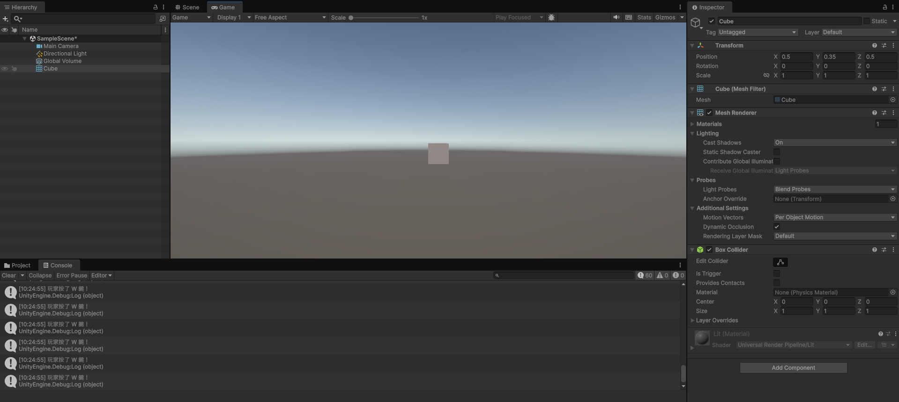
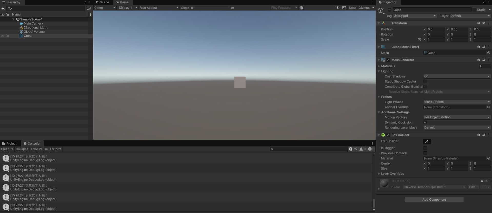
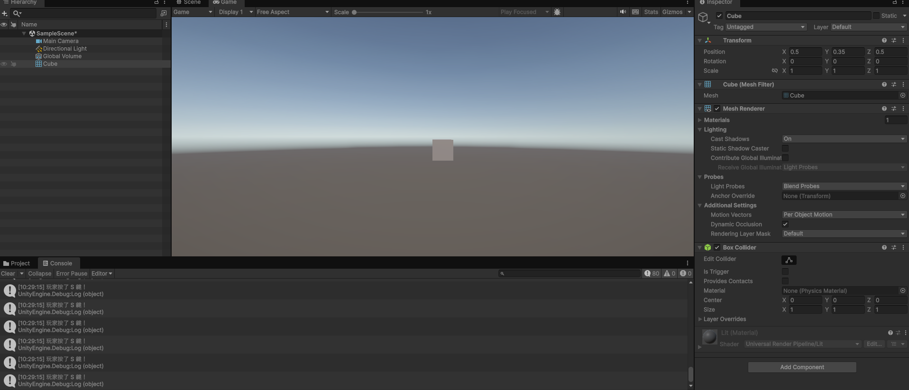
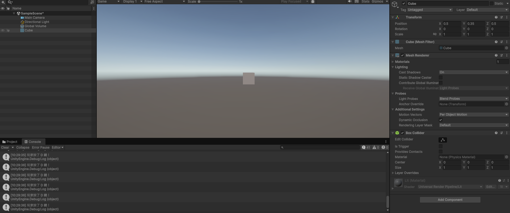

# 第2次練習題目-隨堂-QZ2
>
>學號：113111134
><br />
>姓名：林佩宜
><br />
>作業撰寫時間：90
><br />
>最後撰寫文件日期：2026/10/28 
>

本份文件包含以下主題：(至少需下面兩項，若是有多者可以自行新增)
- [x] 說明內容
- [x] 其他 (可以包含心得或是想跟老師反映)

## 說明內容

開始寫說明，該說明需說明想法，
並於之後再對上述想法的每一部分將程式進一步進行展現，
若需引用程式區則使用下面方法，
若為.cs檔內程式除了於敘述中需註明檔案名稱外，
還需使用語法` ```語言種類 程式碼 ``` `，其中語言種類若是要用python則使用py，java則使用java，C/C++則使用cpp，
下段程式碼為語言種類選擇csharp使用後結果：

```csharp
public void mt_getResult(){
    ...
}
```

若要於內文中標示部分網頁檔，則使用以下標籤` ```html 程式碼 ``` `，
下段程式碼則為使用後結果：

```html
<%@ Page Language="C#" AutoEventWireup="true" ...>

<!DOCTYPE html>

<html xmlns="http://www.w3.org/1999/xhtml">
<head runat="server">
<meta http-equiv="Content-Type" ...>
    <title></title>
</head>
<body>
    <form id="form1" runat="server">
        <div>
        </div>
    </form>
</body>
</html>
```
更多markdown方法可參閱[https://ithelp.ithome.com.tw/articles/10203758](https://ithelp.ithome.com.tw/articles/10203758)

請在撰寫"說明程式與內容"該塊內容，請把原該塊內上述敘述刪除，該塊上述內容只是用來指引該怎麼撰寫內容。

1. (需截圖說明，並且需截圖執行結果)

Ans:
在 Update() 中利用 Keyboard.current.wKey.isPressed 偵測 W 鍵是否被按下，若成立則透過 Debug.Log 在主控台印出「玩家按了 W 鍵！」。

2. (需截圖說明，並且需截圖執行結果)

Ans:  
首先，在程式開頭匯入 UnityEngine.InputSystem 套件，讓遊戲有能力讀取硬體的輸入狀態。接著在每一幀執行的 Update 函式中，透過 Keyboard.current 取得目前的鍵盤物件，並利用 if 條件判斷式配對 keyboard.wKey.isPressed、aKey、sKey 與 dKey 屬性，實時檢查玩家是否有按住 W、A、S、D 鍵。當偵測到相應按鍵被按下時，就會觸發 Debug.Log 函式，在 Console 主控台即時印出「玩家按了 W 鍵！」等對應訊息，用來確認遊戲邏輯與按鍵輸入順利連線。

## 其他

心得:希望未來在進行這類 Unity 程式實作與上機練習時，老師可以先在台前完整示範一次操作步驟與程式碼編寫過程，讓我們看過一次整體流程後，再讓我們動手練習。這樣一來，我們在操作 Unity 介面、建立專案、寫程式以及後續的轉檔與上傳時，比較不會因為步驟繁瑣而漏掉細節。